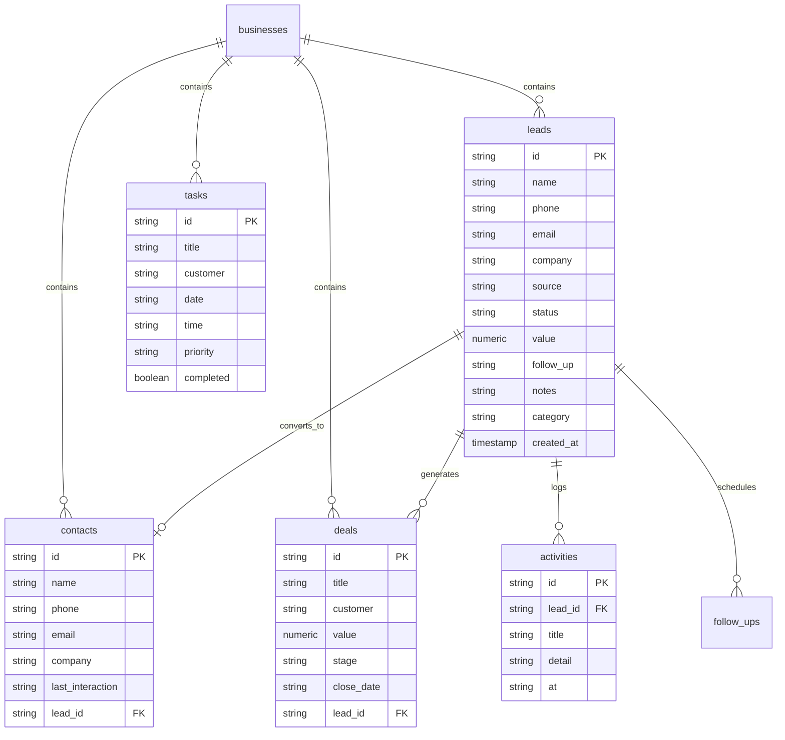

# Occo Flow — Database Architecture & Supabase Integration Documentation

| **Document Version** | 1.0.0 |
| **Database Engine** | PostgreSQL 15+ (Hosted on Supabase) |
| **ORM / Schema Tool** | Prisma ORM (`database/schema.prisma`) |
| **SQL Master File** | `database/schema.sql` |
| **Integration Client**| `@supabase/supabase-js` (`src/lib/supabase.ts`) |

---

## 1. Overview & Directory Structure

All database definitions, migration scripts, ORM schemas, and documentation are strictly centralized in the [`database/`](./) directory:

```text
database/
├── README.md               # Quick-start guide & index
├── DATABASE_DOCS.md        # Comprehensive technical database specification (this file)
├── schema.sql              # Centralized master SQL script for Supabase SQL Editor
└── schema.prisma           # Prisma ORM schema mapping PostgreSQL tables & relationships
```

---

## 2. Supabase Connection Credentials

The application connects to Supabase via environment variables configured in [`.env`](../.env):

```env
# Server-side & Migration Keys
SUPABASE_URL=https://otmasdfjeqaqojfqyfjd.supabase.co
SUPABASE_PUBLISHABLE_KEY=sb_publishable_Zz_2uaYwNzQKEx_yb4MHfg_JxpzQpVr
SUPABASE_SECRET_KEY=sb_secret_your_service_role_key_here
SUPABASE_JWKS_URL=https://otmasdfjeqaqojfqyfjd.supabase.co/auth/v1/.well-known/jwks.json

# Client Vite Keys (bundled to frontend)
VITE_SUPABASE_URL=https://otmasdfjeqaqojfqyfjd.supabase.co
VITE_SUPABASE_ANON_KEY=sb_publishable_Zz_2uaYwNzQKEx_yb4MHfg_JxpzQpVr
VITE_SUPABASE_PUBLISHABLE_KEY=sb_publishable_Zz_2uaYwNzQKEx_yb4MHfg_JxpzQpVr
```

---

## 3. How to Deploy the Schema to Supabase

### Method A: One-Click via Supabase Dashboard (Recommended)
1. Open your Supabase Project Dashboard:
   👉 **[Supabase Project otmasdfjeqaqojfqyfjd](https://supabase.com/dashboard/project/otmasdfjeqaqojfqyfjd)**
2. In the left navigation bar, click on **SQL Editor**.
3. Click **"New query"** (+ button).
4. Open [`database/schema.sql`](./schema.sql), copy the entire file contents, and paste them into the query editor.
5. Click **"Run"** (or press `Ctrl+Enter`).
6. All 7 tables, constraints, foreign keys, indexes, RLS policies, and initial seed records will be created instantly.

### Method B: Using Prisma CLI
If you prefer managing migrations through Prisma:
```bash
# Push schema directly to database
npx prisma db push --schema=database/schema.prisma

# Generate Prisma Client types
npx prisma generate --schema=database/schema.prisma

# Launch visual database studio
npx prisma studio --schema=database/schema.prisma
```

---

## 4. Entity Relationship Model & Table Specifications



### Table 1: `public.leads`
| Column | Type | Constraints | Description |
|---|---|---|---|
| `id` | `TEXT` | PRIMARY KEY | Unique ID (e.g. `l_1`, `l_ab12cd34`) |
| `name` | `TEXT` | NOT NULL | Lead full name |
| `phone` | `TEXT` | DEFAULT '' | Phone / mobile with country code |
| `email` | `TEXT` | DEFAULT '' | Email address |
| `company` | `TEXT` | DEFAULT '' | Organization / business name |
| `source` | `TEXT` | DEFAULT 'Website' | Channel (Website, Referral, Instagram, Google, Walk-in) |
| `status` | `TEXT` | DEFAULT 'New' | Stage: New, Contacted, Qualified, Follow-up, Won, Lost |
| `value` | `NUMERIC(12,2)` | DEFAULT 0 | Estimated deal value |
| `follow_up` | `TEXT` | DEFAULT '' | Human-readable follow-up timestamp string |
| `notes` | `TEXT` | DEFAULT '' | Qualification notes and background context |
| `category` | `TEXT` | DEFAULT 'General' | Industry/service segment |
| `business_id`| `TEXT` | FK -> businesses(id) | Tenant workspace identifier |
| `created_at` | `TIMESTAMPTZ`| DEFAULT now() | Creation UTC timestamp |
| `updated_at` | `TIMESTAMPTZ`| DEFAULT now() | Last update timestamp |

### Table 2: `public.deals`
| Column | Type | Constraints | Description |
|---|---|---|---|
| `id` | `TEXT` | PRIMARY KEY | Unique Deal ID (e.g. `d_1`) |
| `title` | `TEXT` | NOT NULL | Deal title (e.g. "Annual catering contract") |
| `customer` | `TEXT` | NOT NULL | Primary contact or business name |
| `value` | `NUMERIC(12,2)` | DEFAULT 0 | Monetary value of the deal |
| `stage` | `TEXT` | DEFAULT 'New' | Stage: New, Qualified, Proposal, Negotiation, Won, Lost |
| `close_date`| `TEXT` | DEFAULT 'Upcoming' | Target close date |
| `lead_id` | `TEXT` | FK -> leads(id) | Linked source lead |

### Table 3: `public.contacts`
| Column | Type | Constraints | Description |
|---|---|---|---|
| `id` | `TEXT` | PRIMARY KEY | Contact ID (e.g. `c_1`) |
| `name` | `TEXT` | NOT NULL | Contact name |
| `phone` | `TEXT` | DEFAULT '' | Phone number |
| `email` | `TEXT` | DEFAULT '' | Email address |
| `company` | `TEXT` | DEFAULT '' | Company affiliation |
| `last_interaction`| `TEXT` | DEFAULT 'Today' | Time elapsed since last contact |
| `lead_id` | `TEXT` | FK -> leads(id) | Associated origin lead |

### Table 4: `public.tasks`
| Column | Type | Constraints | Description |
|---|---|---|---|
| `id` | `TEXT` | PRIMARY KEY | Task identifier (`t_1`) |
| `title` | `TEXT` | NOT NULL | Task description / action item |
| `customer` | `TEXT` | NOT NULL | Associated client |
| `date` | `TEXT` | DEFAULT 'Today' | Due date string |
| `time` | `TEXT` | DEFAULT '12:00 PM'| Due time string |
| `priority` | `TEXT` | DEFAULT 'Medium'| Priority level: Low, Medium, High |
| `completed`| `BOOLEAN` | DEFAULT false | Completion state |

---

## 5. Row Level Security (RLS) & Access Control

All tables have Row Level Security (`ENABLE ROW LEVEL SECURITY`) activated in PostgreSQL.

In [`database/schema.sql`](./schema.sql), policies are enabled for `SELECT`, `INSERT`, `UPDATE`, and `DELETE` using the publishable anonymous key so that the frontend can read and write data seamlessly. When user authentication (Supabase Auth) is activated in Phase 2, policies can be restricted to:
```sql
CREATE POLICY "Users can access their own business data"
ON public.leads
FOR ALL
USING (auth.uid() = user_id);
```

---

## 6. Realtime Sync & Architecture

The frontend service [`src/lib/supabase.ts`](../src/lib/supabase.ts) communicates directly with Supabase:
- **Optimistic Updates**: State changes locally instantly so the user feels 0 latency.
- **Background Sync**: Mutations asynchronously persist to Supabase.
- **Zero-Failure Fallback**: If Supabase tables are not yet initialized or network is offline, the app seamlessly uses local seed state without throwing errors or breaking the UI.
