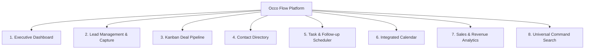

# Occo Flow — Product Requirements Document (PRD)

| **Document Version** | 1.0.0 |
| **Status** | Approved / In Development |
| **Product** | Occo Flow |
| **Target Audience** | Small & Medium Business Owners, Agency Founders, Freelancers, Sales Teams |
| **Core Philosophy** | Zero clutter, mobile-first, instantaneous onboarding, rapid pipeline clarity |

---

## 1. Executive Summary & Vision

**Occo Flow** is an ultra-streamlined, modern Customer Relationship Management (CRM) and sales operating system designed specifically for modern small and medium-sized business owners. 

Most traditional enterprise CRMs (Salesforce, HubSpot, Zoho) are notoriously bloated, difficult to navigate on mobile devices, and require weeks of setup, training, and configuration. Small business operators (agencies, consultancies, local services, fitness studios, digital creators, boutique firms) simply need to:
1. Capture inbound inquiries rapidly.
2. Track deals through standard sales stages.
3. Manage daily follow-up calls and tasks without forgetting any customer.
4. Keep contacts and customer communication history accessible in one place.
5. See their monthly revenue pipeline and conversion health at a glance.

Occo Flow delivers this experience with a sleek, polished interface, instant search, responsive touch-first design, and frictionless workflows.

---

## 2. Target Market & User Personas

### 2.1 Ideal Customer Profile (ICP)
- **Micro & Small Businesses**: 1–25 employees.
- **Service Businesses**: Digital marketing agencies, coaching centers, consulting firms, home services, automotive garages, salons & studios.
- **B2B Consultants & Freelancers**: High-touch deal flow where missing a follow-up directly costs money.
- **Geography**: Global, with built-in multi-currency formatting support (defaulting to clean local currency like ₹/$/€).

### 2.2 User Personas

| Persona | Role | Pain Point | How Occo Flow Solves It |
|---|---|---|---|
| **Alex Morgan** (Owner/Founder) | Agency Principal | Loses track of inbound inquiries from WhatsApp, Instagram, and website; overwhelmed by complicated software. | Clean single-screen Dashboard, 2-click lead capture, clear pipeline totals. |
| **Priya Mehta** (Sales Rep) | Account Executive | Forgets follow-up calls when out in the field or away from desktop. | Mobile-optimized bottom navigation, quick call/email buttons, daily task list with reminders. |
| **Vikram Rao** (Operations Lead) | Service Manager | Disorganized customer contact info spread across spreadsheets and phones. | Centralized Contacts directory, historical activity timeline, deal association. |

---

## 3. Product Scope & Core Features

### 3.1 Feature Breakdown

#### F-01: Executive Dashboard
- **Metric Cards**: Total Pipeline Value, Active Leads Count, Deals Won, Tasks Due Today.
- **Attention Feed**: High-priority follow-ups due in the current session.
- **Recent Activity**: Chronological audit trail of customer interactions and state changes.
- **Quick Action Bar**: Instant trigger to log a lead, create a deal, or add a task.

#### F-02: Lead Management
- **Lifecycle Stages**: `New` ➔ `Contacted` ➔ `Qualified` ➔ `Follow-up` ➔ `Won` ➔ `Lost`.
- **Card-Based View**: Clean, high-legibility cards showing customer name, company, phone, estimated deal value, and next follow-up.
- **Lead Detail View (`/leads/:leadId`)**:
  - Direct communication triggers (Click-to-Call, Click-to-Email, WhatsApp link).
  - Quick stage updater dropdown.
  - Interaction history timeline.
  - Internal customer notes and qualification notes.

#### F-03: Deal Pipeline
- **Pipeline Stages**: `New` ➔ `Qualified` ➔ `Proposal` ➔ `Negotiation` ➔ `Won` ➔ `Lost`.
- **Stage Totals**: Auto-calculated currency aggregates for each stage.
- **Deal Attributes**: Title, Customer/Company link, Value, Expected Close Date, Stage.

#### F-04: Contact Directory
- **Unified Address Book**: Fast searchable repository of customers, decision makers, and suppliers.
- **Company Association**: Grouping contacts by organization.
- **Last Interaction Tracker**: Identifies stale accounts that haven't been contacted recently.

#### F-05: Task & Follow-Up Manager
- **Priority Tiers**: `High`, `Medium`, `Low` with intuitive visual badges.
- **Due Date Grouping**: Tasks organized into Today, Tomorrow, and Upcoming.
- **Checkbox Completion**: Instant completion toggle with visual feedback.

#### F-06: Calendar View
- Visual date grid highlighting scheduled client demos, calls, and follow-up deadlines.

#### F-07: Analytics & Reports
- **Conversion Metrics**: Win rate percentage, average deal size, lead-to-won velocity.
- **Visual Breakdown**: Lead sources breakdown (Website, Instagram, Referrals, Walk-ins, Google).
- **Revenue Forecast**: Weighted pipeline calculation based on active deal stages.

#### F-08: Universal Command Search
- Global modal dialog accessible via `Ctrl/Cmd + K` or header search button.
- Instant fuzzy query matching across Leads, Contacts, Deals, and Tasks simultaneously.

---

## 4. Non-Functional Requirements (NFR)

1. **Performance**:
   - Time to Interactive (TTI): < 1.0s on 4G networks.
   - Client-side navigation: Instantaneous (< 50ms) using TanStack Router.
2. **Mobile Ergonomics**:
   - 100% responsive down to 320px screen width.
   - Thumb-friendly bottom navigation bar on mobile viewports (`< 1024px`).
   - Sticky header with quick-action floating action buttons (FAB).
3. **Accessibility**:
   - WCAG 2.1 Level AA compliance.
   - Focus rings and ARIA labels on all modal and action triggers.
4. **Data Reliability**:
   - Resilient state handling with centralized context provider (`CRMProvider`).
   - Predictable state transitions preventing invalid lead stages.

---

## 5. Release Roadmap

- **Phase 1 (Current - v1.0.0)**: In-memory core CRM workflows, full mobile & desktop responsive UI, TanStack Start SSR shell, complete lead lifecycle, deals, tasks, calendar, search.
- **Phase 2 (v1.1.0)**: Persistent cloud database connection (PostgreSQL / Supabase), user authentication (OAuth + JWT), multi-tenant business workspaces.
- **Phase 3 (v1.2.0)**: WhatsApp Business API integration, automated email notification reminders, Stripe subscription billing.
- **Phase 4 (v2.0.0)**: AI-driven lead scoring and automated sales email drafting.
