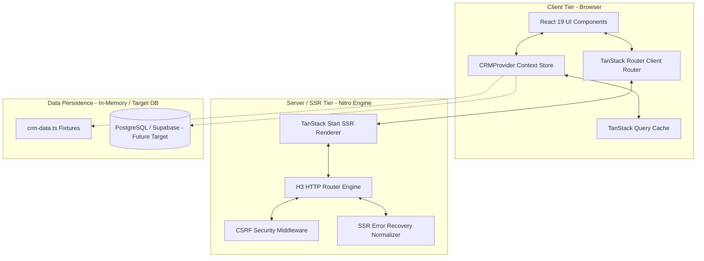
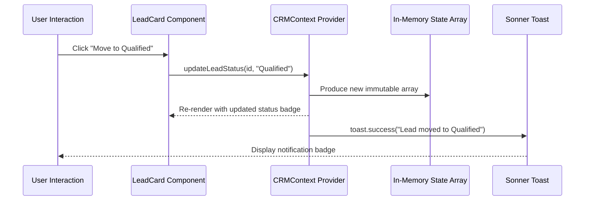

# Occo Flow — Technical Architecture & System Design Document

| **Document Version** | 1.0.0 |
| **System** | Occo Flow |
| **Framework** | TanStack Start (React 19) + Vite 8 + Tailwind CSS v4 |
| **Architecture Pattern** | Hybrid SSR/SPA, File-Based Routing, Unidirectional Data Flow |

---

## 1. System Overview & Architectural Topology

Occo Flow is built on top of **TanStack Start**, a modern full-stack React framework that combines server-side rendering (SSR) capabilities with ultra-responsive client-side Single Page Application (SPA) interactivity.



---

## 2. Technology Stack & Rationale

| Category | Technology | Rationale & Selection Criteria |
|---|---|---|
| **Frontend Framework** | React 19 (`react`, `react-dom`) | Modern concurrent features, action hooks, and optimized reconciliation. |
| **Fullstack Engine** | TanStack Start (`@tanstack/react-start`) | Unified fullstack React framework with SSR, streaming, and built-in type-safe server functions. |
| **Client Routing** | TanStack Router (`@tanstack/react-router`) | 100% type-safe routing, automatic code-splitting, search param validation, and nested layout route management. |
| **Styling & Design System** | Tailwind CSS v4 (`@tailwindcss/vite`) + Radix UI Primitives | Zero-runtime CSS engine with lightning-fast compilation, modern CSS variables, and fully accessible unstyled UI primitives (`@radix-ui/*`). |
| **Server / Bundler Engine** | Vite 8 + Nitro (`nitro/vite`) | Ultra-fast Hot Module Replacement (HMR) during development, universal deployment targets (Cloudflare, Node, Vercel). |
| **Icons & Visuals** | Lucide React (`lucide-react`) | Consistent, tree-shakeable SVG icon family matching modern SaaS design aesthetic. |
| **Form Management** | React Hook Form (`react-hook-form`) + Zod | Lightweight performant validation with schema-based typing. |
| **Notifications** | Sonner (`sonner`) | Elegant, stackable toast notifications with rich feedback states. |

---

## 3. Directory Structure & Modular Breakdown

```text
Occo Flow/
├── docs/                             # Complete project engineering & business docs
│   ├── 01_PRD.md
│   ├── 02_TECHNICAL_ARCHITECTURE.md
│   ├── 03_DATA_MODEL_AND_API_SPEC.md
│   ├── 04_UI_UX_DESIGN_SYSTEM.md
│   ├── 05_USER_MANUAL_AND_FEATURE_GUIDE.md
│   ├── 06_DEPLOYMENT_AND_DEVOPS_GUIDE.md
│   └── 07_SECURITY_QA_AND_TESTING_STRATEGY.md
├── public/                           # Static assets, logo.png, favicon.png, favicon.ico, robots.txt
├── src/
│   ├── components/                   # UI components
│   │   ├── ui/                       # Reusable design tokens (buttons, dialogs, cards)
│   │   ├── crm-shell.tsx             # Responsive layout shell (Sidebar, Header, Bottom Nav)
│   │   └── crm-ui.tsx                # CRM domain components (Cards, QuickForms, Badges)
│   ├── hooks/                        # Custom React hooks (use-mobile.tsx)
│   ├── lib/                          # Core utilities & domain logic
│   │   ├── crm-context.tsx           # Global CRM Context Provider & state mutations
│   │   ├── crm-data.ts               # Type definitions, seed data, currency formatters
│   │   ├── error-capture.ts          # Server error capture and stack normalization
│   │   ├── error-page.ts             # Static fallback HTML 500 error template
│   │   └── utils.ts                  # Class merger utility (clsx + twMerge)
│   ├── routes/                       # File-based TanStack routes
│   │   ├── __root.tsx                # App root route: HTML shell, QueryClient, CRMProvider
│   │   ├── index.tsx                 # Dashboard view (KPIs, active leads, attention queue)
│   │   ├── leads.tsx                 # Leads catalog view & quick filtering
│   │   ├── leads.$leadId.tsx         # Detailed lead page: communications, stages, timeline
│   │   ├── contacts.tsx              # Contact address book & directory
│   │   ├── deals.tsx                 # Deal pipeline & stage management
│   │   ├── tasks.tsx                 # Task checklist & follow-up scheduler
│   │   ├── calendar.tsx              # Month/week appointment agenda
│   │   ├── analytics.tsx             # Revenue metrics & lead source conversion charts
│   │   ├── settings.tsx              # Workspace profile & business preferences
│   │   └── more.tsx                  # Mobile overflow navigation menu
│   ├── routeTree.gen.ts              # Automatically generated route tree manifest
│   ├── router.tsx                    # Router factory function
│   ├── server.ts                     # Server entrypoint with SSR error boundaries
│   ├── start.ts                      # TanStack Start instance & CSRF middleware
│   └── styles.css                    # Design system variables & Tailwind CSS imports
├── package.json                      # Clean dependencies (zero third-party editor locks)
├── tsconfig.json                     # Strict TypeScript compiler options
└── vite.config.ts                    # Native Vite + TanStack Start + Nitro configuration
```

---

## 4. Routing Strategy & Navigation Topology

TanStack Router uses **strictly typed file-based routing**:

1. **`__root.tsx`**: Top-level shell that renders the HTML document structure, global CSS links, fonts, `QueryClientProvider`, `CRMProvider`, and `AppShell`.
2. **Leaf Routes**:
   - `/`: Dashboard root.
   - `/leads`: Inbound lead catalog.
   - `/leads/$leadId`: Dynamic segment route with parameter extraction (`params.leadId`).
   - `/contacts`, `/deals`, `/tasks`, `/calendar`, `/analytics`, `/settings`: Feature-specific leaf routes.
3. **Route Preloading**: Links use intent preloading (`preload="intent"`), pre-fetching route chunks on hover or touchstart for instantaneous navigation.

---

## 5. State Management & Data Flow Architecture



### 5.1 In-Memory Reactive Architecture (Version 1)
- State resides in `CRMProvider` (`crm-context.tsx`), exposing state accessors (`leads`, `contacts`, `deals`, `tasks`) and immutable dispatch actions (`addLead`, `updateLeadStatus`, `addDeal`, `updateDealStage`, `addTask`, `toggleTask`).
- This design guarantees that data is isolated, clean, and easily hot-swapped for a persistent REST or GraphQL backend in Version 2.

### 5.2 Transition Path to Persistent Backend (Version 2)
```typescript
// Example: Swapping local state with TanStack Query mutations
export function useUpdateLead() {
  const queryClient = useQueryClient();
  return useMutation({
    mutationFn: async ({ id, status }: { id: string; status: LeadStatus }) => {
      const res = await fetch(`/api/leads/${id}`, {
        method: "PATCH",
        headers: { "Content-Type": "application/json" },
        body: JSON.stringify({ status }),
      });
      return res.json();
    },
    onSuccess: () => queryClient.invalidateQueries({ queryKey: ["leads"] }),
  });
}
```

---

## 6. Server-Side Rendering (SSR) & Error Resilience

1. **Server Entry (`server.ts`)**:
   - Integrates with Nitro to serve cloud environments.
   - Handles uncaught exceptions by returning an unhandled error recovery page (`error-page.ts`), preventing blank white screens.
2. **CSRF Protection (`start.ts`)**:
   - `createCsrfMiddleware` validates server action headers to protect endpoints from cross-site request forgery attacks.
3. **Hydration**:
   - Client reconciles the initial server-rendered HTML effortlessly with zero layout shifts.
