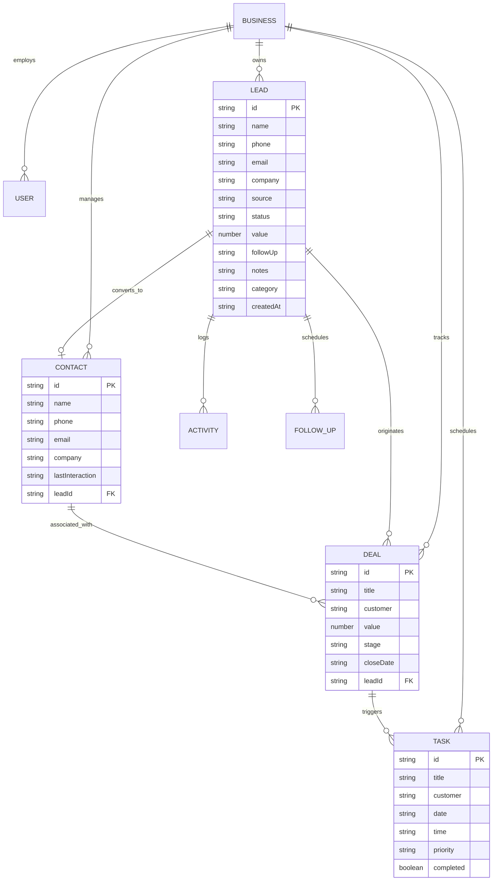

# Occo Flow — Data Model & API Specification

| **Document Version** | 1.0.0 |
| **Status** | Approved |
| **Schema Compatibility** | PostgreSQL 15+ / Prisma / Supabase |
| **Centralized Database Files** | [`database/schema.sql`](../database/schema.sql), [`database/schema.prisma`](../database/schema.prisma) |

---

## 1. Entity Relationship Diagram (ERD)



---

## 2. Core Domain Types & TypeScript Contracts

All core domain definitions reside in [`src/lib/crm-data.ts`](../src/lib/crm-data.ts).

### 2.1 Enums & Literal Unions

```typescript
export type LeadStatus = 
  | "New"          // Inbound enquiry received, uncontacted
  | "Contacted"    // First touch completed (call/email/message)
  | "Qualified"    // Requirement validated and budget confirmed
  | "Follow-up"    // Active negotiation/proposal review
  | "Won"          // Successfully converted to customer
  | "Lost";        // Disqualified or lost to competitor

export type DealStage = 
  | "New"          // Deal created in pipeline
  | "Qualified"    // Needs assessment validated
  | "Proposal"     // Formal proposal or pricing submitted
  | "Negotiation"  // Contract or rate discussion underway
  | "Won"          // Payment confirmed / contract signed
  | "Lost";        // Closed without sale

export type Priority = "Low" | "Medium" | "High";
```

### 2.2 Data Interfaces

```typescript
export interface Lead {
  id: string;
  name: string;
  phone: string;
  email: string;
  company: string;
  source: string;        // e.g. "Website", "Referral", "Instagram", "Walk-in"
  status: LeadStatus;
  value: number;         // Estimated deal value in integer units
  followUp: string;      // Human-readable follow-up schedule (e.g. "Today, 2:00 PM")
  notes: string;         // Qualification criteria, preferences
  createdAt: string;     // ISO timestamp or human-relative date string
  category: string;      // Business service type
}

export interface Contact {
  id: string;
  name: string;
  phone: string;
  email: string;
  company: string;
  lastInteraction: string;
  leadId?: string;
}

export interface Deal {
  id: string;
  title: string;
  customer: string;
  value: number;
  stage: DealStage;
  closeDate: string;
  leadId?: string;
}

export interface Task {
  id: string;
  title: string;
  customer: string;
  date: string;
  time: string;
  priority: Priority;
  completed: boolean;
}

export interface Activity {
  id: string;
  leadId: string;
  title: string;
  detail: string;
  at: string;
}

export interface FollowUp {
  id: string;
  leadId: string;
  date: string;
  time: string;
  reminder: boolean;
}
```

---

## 3. Zod Validation Schemas

For client and server validation:

```typescript
import { z } from "zod";

export const LeadSchema = z.object({
  name: z.string().min(2, "Name must be at least 2 characters"),
  phone: z.string().min(7, "Valid phone number required"),
  email: z.string().email("Valid email required"),
  company: z.string().min(2, "Company name required"),
  source: z.string().default("Website"),
  status: z.enum(["New", "Contacted", "Qualified", "Follow-up", "Won", "Lost"]).default("New"),
  value: z.number().nonnegative().default(0),
  category: z.string().min(2, "Category required"),
  notes: z.string().optional().default(""),
});

export const DealSchema = z.object({
  title: z.string().min(2, "Deal title required"),
  customer: z.string().min(2, "Customer name required"),
  value: z.number().positive("Value must be greater than 0"),
  stage: z.enum(["New", "Qualified", "Proposal", "Negotiation", "Won", "Lost"]).default("New"),
  closeDate: z.string(),
  leadId: z.string().optional(),
});

export const TaskSchema = z.object({
  title: z.string().min(3, "Task description required"),
  customer: z.string().min(2, "Customer reference required"),
  date: z.string(),
  time: z.string(),
  priority: z.enum(["Low", "Medium", "High"]).default("Medium"),
  completed: z.boolean().default(false),
});
```

---

## 4. RESTful API Specification (Version 2 Backend Roadmap)

When migrating to a persistent API server, endpoints will follow standard REST conventions with JSON payloads:

### 4.1 Leads Endpoints

| Method | Endpoint | Description | Request Body | Response Status |
|---|---|---|---|---|
| `GET` | `/api/v1/leads` | List leads (supports `?status=...&search=...`) | None | `200 OK` (Array) |
| `POST` | `/api/v1/leads` | Create new lead | `LeadSchema` | `201 Created` |
| `GET` | `/api/v1/leads/:id` | Get single lead with activity history | None | `200 OK` |
| `PATCH` | `/api/v1/leads/:id` | Update lead properties (e.g. status) | Partial `Lead` | `200 OK` |
| `DELETE` | `/api/v1/leads/:id` | Delete or archive lead | None | `204 No Content` |

### 4.2 Deals Endpoints

| Method | Endpoint | Description | Request Body | Response Status |
|---|---|---|---|---|
| `GET` | `/api/v1/deals` | List all deals grouped by stage | None | `200 OK` |
| `POST` | `/api/v1/deals` | Create new deal | `DealSchema` | `201 Created` |
| `PATCH` | `/api/v1/deals/:id/stage`| Move deal across pipeline stages | `{ stage: DealStage }` | `200 OK` |

### 4.3 Tasks Endpoints

| Method | Endpoint | Description | Request Body | Response Status |
|---|---|---|---|---|
| `GET` | `/api/v1/tasks` | Get pending & completed tasks | None | `200 OK` |
| `POST` | `/api/v1/tasks` | Create follow-up task | `TaskSchema` | `201 Created` |
| `PATCH` | `/api/v1/tasks/:id/toggle`| Toggle task completion status | `{ completed: boolean }`| `200 OK` |
