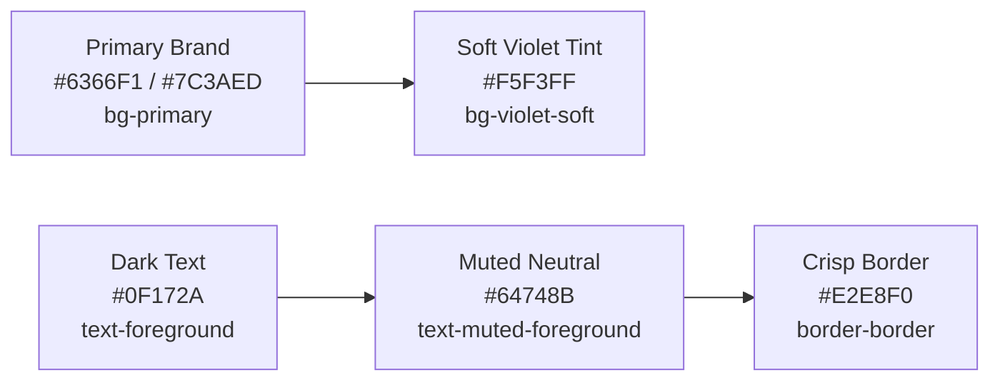

# Occo Flow — UI/UX Design System & Component Guidelines

| **Document Version** | 1.0.0 |
| **Design Framework** | Custom Design System built on Tailwind CSS v4 & Radix UI |
| **Typography Family** | *Plus Jakarta Sans* (Display/Headings), *DM Sans* (Body/Interface) |
| **Primary Theme** | Modern Clean Light Theme with Violet/Indigo Accent System |

---

## 1. Design Philosophy & Guiding Principles

1. **Clarity Over Cleverness**:
   Every pixel in Occo Flow serves a single objective: enabling a business owner to glance at their pipeline and know who to contact next within 3 seconds.
2. **Mobile-First & Touch Ergonomic**:
   Sales often happens on the go. The entire user experience is engineered to be operable with one hand via a dedicated bottom navigation bar on mobile screens.
3. **Information Density Without Overwhelm**:
   Data is organized into high-contrast, scannable cards with distinct typography and color-coded status badges.
4. **Instant Feedback**:
   Every state change (stage movement, task completion, contact creation) produces instant visual feedback with optimistic UI updates and toast confirmations.

---

## 2. Color Palette & Token System

All color tokens are mapped through CSS custom properties in [`src/styles.css`](../src/styles.css) and utilized via Tailwind CSS classes:



### 2.1 Core Semantic Palette

| Token Name | Tailwind Class | Hex / HSL Equivalent | Usage Context |
|---|---|---|---|
| **Primary Brand** | `bg-primary`, `text-primary` | `#6366F1` (Indigo/Violet) | Main CTA buttons, active sidebar links, brand marks |
| **Primary Hover** | `hover:bg-primary/90` | `#4F46E5` | Hover state for interactive primary actions |
| **Soft Violet Tint** | `bg-violet-soft` | `rgba(99, 102, 241, 0.10)` | User avatar badge background, secondary highlights |
| **Card Background** | `bg-card` | `#FFFFFF` | Lead cards, deal tiles, task containers, modals |
| **App Background** | `bg-background` | `#F8FAFC` (Slate 50) | Main viewport canvas, outer container |
| **Text Foreground** | `text-foreground` | `#0F172A` (Slate 900) | Main headings, customer names, primary monetary values |
| **Muted Text** | `text-muted-foreground` | `#64748B` (Slate 500) | Secondary metadata, phone numbers, timestamps |
| **Subtle Border** | `border-border` | `#E2E8F0` (Slate 200) | Section dividers, input borders, card outlines |

### 2.2 Status & Stage Colors

| State / Stage | Background Class | Text Class | Indicator |
|---|---|---|---|
| **New / Fresh** | `bg-blue-50` | `text-blue-700` | 🔵 Inbound, uncontacted |
| **Qualified / Active** | `bg-amber-50` | `text-amber-700` | 🟡 Requirement validated |
| **Follow-up / In Progress** | `bg-purple-50` | `text-purple-700` | 🟣 Active dialogue scheduled |
| **Won / Closed Deal** | `bg-emerald-50` | `text-emerald-700` | 🟢 Deal completed, revenue booked |
| **Lost / Disqualified** | `bg-rose-50` | `text-rose-700` | 🔴 Deal rejected or disqualified |

---

## 3. Typography Hierarchy

Occo Flow leverages Google Fonts loaded via `<link>` tags in `__root.tsx`:

```css
/* Display & Titles */
font-family: 'Plus Jakarta Sans', system-ui, sans-serif;

/* Body, Tables & Controls */
font-family: 'DM Sans', -apple-system, sans-serif;
```

### Scale & Weight Specifications

| Element | Class | Font Size / Weight | Visual Example |
|---|---|---|---|
| **Page H1 Title** | `font-display text-xl font-bold` | 20px / 700 Bold | `Workspace / Leads` |
| **Card Titles / Names** | `font-sans text-sm font-semibold` | 14px / 600 SemiBold | `Rahul Sharma (FitWell Studio)` |
| **Metric Currency** | `font-display text-2xl font-extrabold` | 24px / 800 ExtraBold | `₹5,40,000` |
| **Metadata & Subtext**| `font-sans text-xs text-muted-foreground` | 12px / 400 Regular | `Follow-up: Today, 2:00 PM` |
| **Micro Labels** | `text-[10px] font-bold uppercase tracking-wider` | 10px / 700 Bold | `WORKSPACE` |

---

## 4. Layout Architecture & Responsive Breakpoints

The user interface automatically adapts between two dedicated view configurations:

```text
Desktop View (≥ 1024px):
+--------------------+---------------------------------------------------------------+
|                    |  Sticky Header (Breadcrumbs, Search Input, Add Entity Button) |
|  Fixed Sidebar     +---------------------------------------------------------------+
|  (246px Width)     |                                                               |
|  - Brand Logo      |  Main Content Workspace (max-w-[1500px])                     |
|  - Navigation Links|  - Cards Grid                                                 |
|  - User Profile    |  - Filter Bars                                                |
|                    |  - Modals & Drawers                                           |
+--------------------+---------------------------------------------------------------+

Mobile View (< 1024px):
+------------------------------------------------------------------------------------+
|  Mobile Header (Logo Mark, Compact Search Button, Avatar)                          |
+------------------------------------------------------------------------------------+
|                                                                                    |
|  Vertical Scrollable Viewport (Cards, Quick Actions, Details)                     |
|                                                                                    |
+------------------------------------------------------------------------------------+
|  [+] Floating Action Button (Quick Add)                                            |
|  Floating Bottom Nav (Home, Leads, Deals, Tasks, More)                             |
+------------------------------------------------------------------------------------+
```

---

## 5. Core Reusable Component Catalog

1. **`Brand` Component** ([`src/components/crm-shell.tsx`](../src/components/crm-shell.tsx)):
   - Renders the violet squircle container with sparkle icon and `Occo Flow` bold typography.
2. **`QuickForm` Modal / Drawer** ([`src/components/crm-ui.tsx`](../src/components/crm-ui.tsx)):
   - Unified modal dialog for rapid entity creation (Leads, Deals, Tasks, Contacts).
   - Form state management, validation feedback, and immediate context store update.
3. **`CommandSearch` Dialog**:
   - Universal query search triggered via header or keyboard shortcut.
   - Searches across all four primary entities with instant result jump links.
4. **`LeadCard` & `DealCard`**:
   - Touch-friendly cards with visual status pills, quick action buttons, and direct phone/email triggers.
