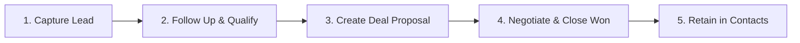

# Occo Flow — User Manual & Functional Feature Guide

| **Document Version** | 1.0.0 |
| **Audience** | Business Owners, Sales Executives, Account Managers, Admin Users |
| **Product Edition** | Occo Flow Standard Edition |

---

## 1. Getting Started with Occo Flow

Welcome to **Occo Flow**! Occo Flow is built to help you run your entire customer acquisition and sales pipeline from a single clean screen—whether you are on your laptop in the office or on your phone visiting a client.

---

## 2. Navigating the Workspace

### 2.1 The Dashboard (`/`)
When you log in, your executive overview displays 4 essential cards:
1. **Total Pipeline Value**: Aggregate currency value of all open deals.
2. **Active Leads**: Total prospects currently in active dialogue.
3. **Deals Won**: Count and revenue of closed-won deals for the period.
4. **Tasks Due Today**: Action items requiring your immediate attention.

Beneath the KPI cards, the **Attention Queue** lists pending calls and meetings scheduled for the current day.

---

## 3. Lead Management Workflow

### 3.1 Adding a New Lead
1. Click the **"+ Add Lead"** button in the top navigation header (or the floating **`+`** button on mobile).
2. Fill in the required details:
   - **Name**: Prospect's full name (e.g. *Rahul Sharma*).
   - **Company**: Business or organization name (e.g. *FitWell Studio*).
   - **Phone**: Contact number (with country code).
   - **Email**: Direct email address.
   - **Deal Value**: Estimated budget or deal size.
   - **Category**: Service requested (e.g. *Gym Membership*, *Website Redesign*).
   - **Lead Source**: How they found you (*Website*, *Instagram*, *Referral*, *Walk-in*).
3. Click **"Save Lead"**. The lead will appear instantly at the top of your list.

### 3.2 Lead Detail View (`/leads/:leadId`)
Click on any lead card to open their full profile:
- **One-Tap Actions**:
  - 📞 **Call**: Triggers your phone or VoIP dialer.
  - ✉️ **Email**: Opens your email client pre-addressed to the contact.
  - 💬 **WhatsApp**: Opens WhatsApp Web / Mobile directly to chat with the prospect.
- **Stage Progression Dropdown**: Move leads from `New` ➔ `Contacted` ➔ `Qualified` ➔ `Follow-up` ➔ `Won` ➔ `Lost`.
- **Notes & History**: Log meeting summaries, customer preferences, and requirements.

---

## 4. Deals & Pipeline Tracking

The **Deals** section (`/deals`) helps you track expected revenue through each phase of your sales cycle:

| Stage | Meaning | Recommended Action |
|---|---|---|
| **New** | Deal just identified | Initial needs assessment |
| **Qualified** | Budget and authority verified | Schedule solution demonstration |
| **Proposal** | Quotation / scope of work delivered | Follow up within 48 hours |
| **Negotiation** | Terms, pricing, or contract adjustments | Resolve objections, finalize terms |
| **Won** | Contract signed / deposit received | Celebrate and transition to onboarding! |
| **Lost** | Prospect declined or chose competitor | Log loss reason for future analytics |

---

## 5. Daily Tasks & Follow-Up Scheduler

The **Tasks** view (`/tasks`) ensures zero follow-ups slip through the cracks:
- **Priority Badges**:
  - 🔴 **High Priority**: Crucial client deadlines or hot deals.
  - 🟡 **Medium Priority**: Standard follow-up check-ins.
  - 🔵 **Low Priority**: General administrative reminders.
- **One-Click Completion**: Click the circle checkbox next to any task to mark it done.
- **Adding a Task**: Click **"Add Task"** ➔ enter the task title, customer name, date, time, and priority level.

---

## 6. Contacts Directory

The **Contacts** view (`/contacts`) maintains a clean, searchable database of everyone you do business with:
- Search by customer name or company name.
- View **Last Interaction** timestamps to spot stale relationships.
- Seamlessly navigate from a contact to their active deals or lead history.

---

## 7. Sales & Revenue Analytics

The **Analytics** view (`/analytics`) gives founders clear insight into business growth:
- **Lead Source Performance**: Identify which channels produce the highest value customers (e.g. Instagram vs. Word of Mouth).
- **Stage Distribution**: Visualize how many deals are currently sitting in Proposal vs. Negotiation.
- **Win Rate Percentage**: Ratio of closed-won opportunities versus lost deals.

---

## 8. Keyboard Shortcuts & Quick Search

| Action | Shortcut (Desktop) | Description |
|---|---|---|
| **Global Search** | Click Search Bar or `Ctrl/Cmd + K` | Search leads, contacts, deals, and tasks instantly |
| **Navigate to Home** | Click Brand Logo | Returns to `/` dashboard |
| **Notifications** | Bell Icon | View system reminders and follow-up notices |
