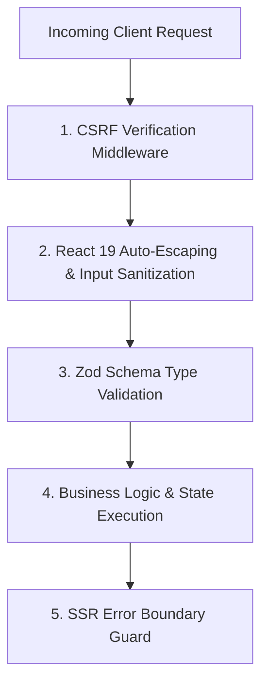

# Occo Flow — Security, Compliance & QA Testing Strategy

| **Document Version** | 1.0.0 |
| **Classification** | Engineering Standards & Quality Assurance |
| **Compliance Readiness**| SOC2 Type II Principles, GDPR Data Privacy Alignment |

---

## 1. Security Architecture & Threat Mitigation



### 1.1 Cross-Site Request Forgery (CSRF) Protection
As implemented in [`src/start.ts`](../src/start.ts):
```typescript
const csrfMiddleware = createCsrfMiddleware({
  filter: (ctx) => ctx.handlerType === "serverFn",
});
```
All server function invocations strictly enforce standard CSRF verification tokens, preventing unauthorized state modification across origin boundaries.

### 1.2 Cross-Site Scripting (XSS) Prevention
- React 19 automatically escapes all text nodes rendered in JSX.
- Raw HTML injection (`dangerouslySetInnerHTML`) is strictly disallowed across all CRM components.
- Phone numbers, emails, and URLs are validated before being used in `href="tel:..."` or `href="mailto:..."` links.

### 1.3 Error Sanitization & Leakage Prevention
In [`src/lib/error-capture.ts`](../src/lib/error-capture.ts) and [`src/lib/error-page.ts`](../src/lib/error-page.ts):
- Unhandled production errors are intercepted by server error boundaries.
- Stack traces and sensitive database credentials are suppressed from client-facing responses, presenting a graceful recovery screen instead of exposing system internals.

---

## 2. Testing Strategy & Test Pyramid

```text
            / \
           /   \        E2E Tests (Playwright)
          / E2E \       - Critical paths: Add Lead -> Convert to Deal -> Mark Won
         /-------\
        /  Integ  \     Integration Tests (Testing Library)
       /   Tests   \    - Context mutations, dialog modals, search palette
      /-------------\
     /     Unit      \  Unit Tests (Vitest)
    /     Tests       \ - Currency formatters, Zod schema validation, data transforms
   /-------------------\
```

### 2.1 Unit Tests (Vitest)
Unit tests validate pure logic, validation rules, and helpers:
```typescript
import { describe, it, expect } from "vitest";
import { money } from "../src/lib/crm-data";

describe("CRM Utilities", () => {
  it("formats Indian Rupee currency correctly", () => {
    expect(money(50000)).toBe("₹50,000");
    expect(money(120000)).toBe("₹1,20,000");
  });
});
```

### 2.2 Integration Tests (React Testing Library)
Verifies component behavior within the `CRMProvider`:
- Opening the quick-add lead modal.
- Entering lead details and asserting that the card appears in the list.
- Toggling a task checkbox and verifying state transition.

### 2.3 End-to-End Tests (Playwright)
Validates core end-to-end user workflows:
1. User lands on `/` dashboard.
2. Clicks "+ Add Lead" and submits form.
3. Navigates to `/leads`, finds new lead, clicks to open `/leads/:leadId`.
4. Updates status from `New` to `Qualified`.
5. Verifies toast notification appears.

---

## 3. QA Pre-Flight Release Checklist

Before any production deployment or release tag:

- [x] **Zero Third-Party Editor Locks**: Verify no telemetry, tracking scripts, or vendor-locked configs remain in codebase.
- [x] **Clean Production Build**: Run `npm run build` — must exit with code `0`.
- [x] **Responsive Layouts**:
  - [x] Mobile viewport (375px, iPhone SE / 14): Bottom navigation bar renders cleanly, floating action button accessible.
  - [x] Tablet viewport (768px, iPad): Grid adjusts smoothly.
  - [x] Desktop viewport (1280px+): Fixed sidebar and full header action bar render properly.
- [x] **Lead Lifecycle**:
  - [x] Adding a lead updates all counters (Dashboard active leads, total pipeline value).
  - [x] Dynamic route `/leads/:leadId` opens corresponding lead details.
  - [x] Click-to-call, click-to-email, and WhatsApp triggers fire valid protocols.
- [x] **Deal Pipeline**: Stage updates recalculate aggregates without throwing hydration errors.
- [x] **Search**: Universal search modal opens on click, matches queries instantly, and allows jumping to result pages.
- [x] **Asset Verification**: `favicon.png`, `favicon.ico`, and `logo.png` load properly in tab bar and brand headers.
